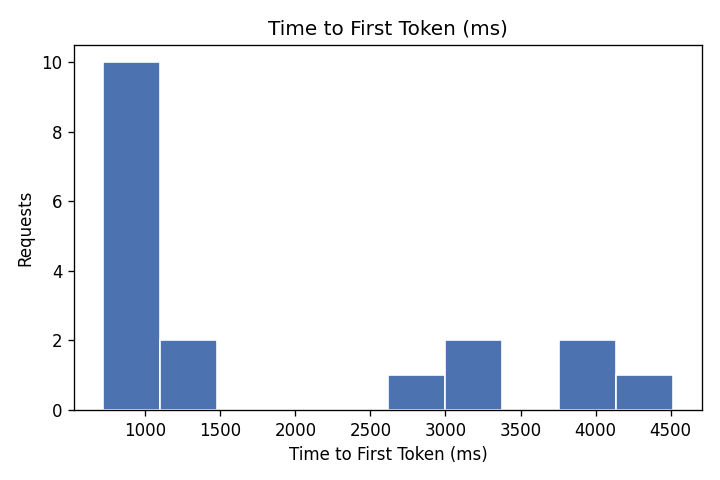
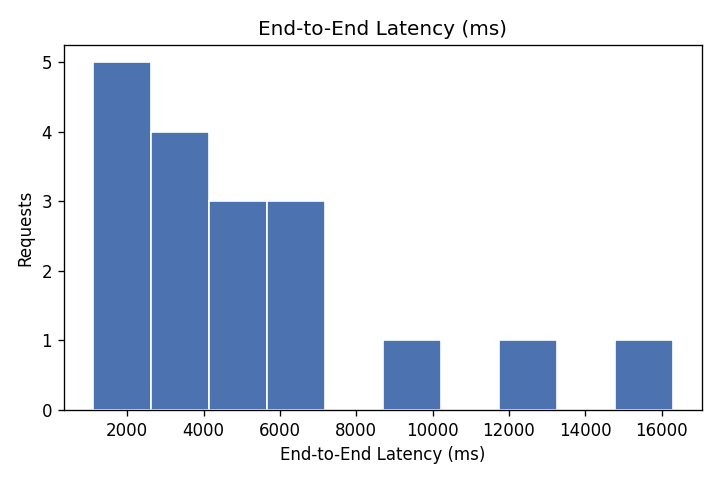
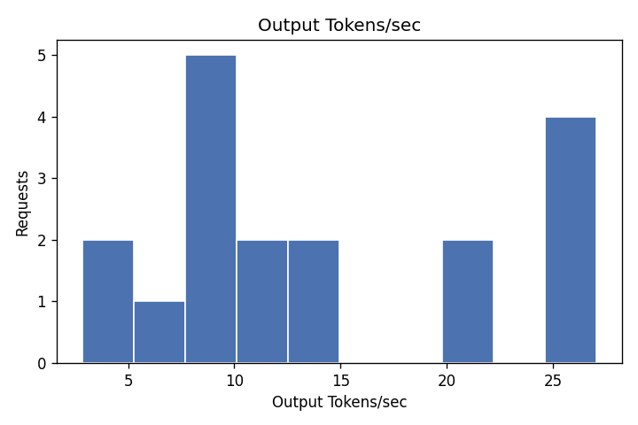

# Baseline report: run 43617881-5053-492f-8fb0-559db059660c

Status: **completed**

## Hardware
| Field | Value |
|---|---|
| OS | Windows (Windows-11-10.0.26300-SP0) |
| Python | 3.12.0 |
| CPU | 8 physical / 16 logical cores |
| RAM | 16.54 GB total, 2.41 GB available |
| GPU | NVIDIA GeForce RTX 3050 Laptop GPU (4096 MiB VRAM) |
| Disk | 58.59 GB free of 1022.55 GB |

## Model & backend
| Field | Value |
|---|---|
| Model | qwen2.5-0.5b-instruct |
| Quantization | Q4_K_M |
| Context limit | 2048 tokens |
| Tokenizer | Qwen/Qwen2.5-0.5B-Instruct |
| Revision | 9217f5db79a29953eb74d5343926648285ec7e67 |
| Backend | llama-cpp |
| Git commit | c73c2ea7579fba717c964166c78620571e749440 |

## Per-repeat metrics
| repeat | latency_p50_ms | latency_p95_ms | latency_p99_ms | ttft_p50_ms | tpot_p50_ms | throughput_p50_tps | requests_per_second | failure_rate |
|---|---|---|---|---|---|---|---|---|
| 0 | 3829.312200003187 | 5239.288500008115 | 5315.241780008364 | 805.5605000045034 | 32.80880141340146 | 18.969339389754385 | 0.2676567253248519 | 0.0 |
| 1 | 5163.138100004289 | 8665.848099990399 | 9090.718099990045 | 1019.3647499982035 | 38.6012000002004 | 11.042930104180972 | 0.20648992961862095 | 0.0 |
| 2 | 5980.5317499995 | 15170.756900006381 | 16071.225620007319 | 1338.944300005096 | 48.52003260511228 | 10.758895346340399 | 0.1379969856214614 | 0.0 |

## Repeat-to-repeat variability
- latency_ms_p50: mean=4990.99, stddev=1085.89, CV=0.218 (values: [3829.312200003187, 5163.138100004289, 5980.5317499995])
- ttft_ms_p50: mean=1054.62, stddev=268.43, CV=0.255 (values: [805.5605000045034, 1019.3647499982035, 1338.944300005096])
- tpot_ms_p50: mean=39.98, stddev=7.95, CV=0.199 (values: [32.80880141340146, 38.6012000002004, 48.52003260511228])
- throughput_tokens_per_second_p50: mean=13.59, stddev=4.66, CV=0.343 (values: [18.969339389754385, 11.042930104180972, 10.758895346340399])

## Flags
- **[WARNING] low_available_memory**: Only 2.41 GB RAM free at run time; results may reflect machine contention rather than clean baseline performance.
- **[WARNING] high_repeat_variability**: throughput_tokens_per_second_p50: coefficient of variation 0.34 across repeats exceeds 0.3 -- repeats are not directly comparable.
- **[INFO] gpu_memory_not_process_attributed**: GPU memory samples (if present) report whole-device usage via pynvml, not this run's own attribution -- see docs/baseline.md.

## Comparisons (internal consistency only)
- [PASS] repeat 0: TTFT p50 <= latency p50 -- ttft_p50=805.5605000045034ms latency_p50=3829.312200003187ms
- [PASS] repeat 1: TTFT p50 <= latency p50 -- ttft_p50=1019.3647499982035ms latency_p50=5163.138100004289ms
- [PASS] repeat 2: TTFT p50 <= latency p50 -- ttft_p50=1338.944300005096ms latency_p50=5980.5317499995ms
- [PASS] No documented SLA or expected-performance target exists yet for this model+hardware combination -- this is the first baseline run. -- Informational only; not a pass/fail check against an external target.

## Distribution plots

## Validation against raw observations
- repeat 0: OK
- repeat 1: OK
- repeat 2: OK